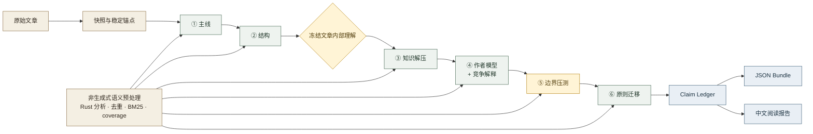

<div align="center">

# Readwelt

### 不是把长文压短，而是把压缩在文章里的思想重新展开。

本地优先、可审计的六阶段逆向阅读运行时

[](https://github.com/lunnynight/readwelt/actions/workflows/ci.yml)
[](pyproject.toml)
[](crates/readwelt-core)
[](LICENSE)

</div>

---

Readwelt 不追求“快速理解”，也不生成一段看起来合理的摘要。它先冻结文章内部的
主线与结构，再解压被作者省略的前置知识，重建作者如何观察和选择问题，压力测试
其成立边界，最后只迁移仍然站得住的原则。

> **输入是一篇文章；输出不是答案，而是一条可以回到原文、检查证据、保留分歧的理解链。**

## 它如何阅读



| 阶段 | 要解决的问题 | 不能越过的线 |
|---|---|---|
| 1 · 文章主线 | 作者在回答什么、主要主张和内部依据是什么 | 只读原文锚点，不引入背景或理论 |
| 2 · 论证结构 | 主张、前提、证据、反对与限定如何连接 | 区分作者主张、引述和系统推断 |
| 3 · 知识解压 | 哪些背景、概念和前置知识被压缩了 | 只能支持、限定或挑战，不能回写 Stage 1–2 |
| 4 · 作者模型 | 作者为何这样提出问题、选择什么、放弃什么 | 推测必须标明距离，并保留竞争解释 |
| 5 · 边界压测 | 主张依赖哪些条件，在哪里会失效 | 反例、缺失证据和未决冲突不能被抹平 |
| 6 · 原则迁移 | 哪些机制能离开原语境继续成立 | 只能从 Stage 5 已接受或有限定的主张迁移 |

模型在每一阶段只提交候选。阶段顺序、原文锚点、证据可见范围、竞争解释中介、
Stage 6 lineage 和最终 ledger 由确定性门禁控制。流程跑完不等于“已经理解”：
执行状态与认识状态分开记录，材料不足可以得到 `partial` 或 `underdetermined`。

## Quickstart

需要 [uv](https://docs.astral.sh/uv/)、Python 3.13 和 Rust stable。

```powershell
git clone https://github.com/lunnynight/readwelt.git
cd readwelt
uv sync --all-extras
uv run pytest
```

先体验不调用生成模型的导入与语义准备：

```powershell
uv run readwelt import .\article.txt --json
# 从输出复制 document_id
uv run readwelt prepare <document_id> --json
```

完整逆向阅读需要一个支持 `/chat/completions` 与 JSON Schema structured output 的
OpenAI-compatible 模型。以本地服务为例：

```powershell
$env:READWELT_LOCAL_MODEL = "your-model"
$env:READWELT_LOCAL_BASE_URL = "http://127.0.0.1:11434/v1"

uv run readwelt read .\article.txt --provider local --json
```

使用远程 OpenAI-compatible API：

```powershell
$env:READWELT_API_MODEL = "your-model"
$env:READWELT_API_KEY = "..."
$env:READWELT_API_BASE_URL = "https://api.example.com/v1"

uv run readwelt read .\article.txt --provider api --json
```

`read` 可以接收文件路径或已有 `document_id`。Xberg `1.0.0rc38` 负责文档抽取；
源文件不会被原地修改。

## 为什么先做非生成式预处理

重复把全文交给生成模型，既昂贵，也无法说明模型究竟看过哪些段落。Readwelt 先建立
`SemanticAtlas`：Rust 内核执行规范化后的批量文本分析、SHA-256、重复/近重复候选、
BM25 排序与 coverage 计算，Python 侧把这些确定性结果组织成按章节平衡的
`EvidencePacket`。

这层计算不生成文本。它负责“哪里值得读”和“哪里还没读到”，生成模型只负责作者
问题意识、隐含前提、边界与迁移等高价值推理。证据包记录：

- 实际送入模型的稳定 `SpanAnchor`；
- 已覆盖与遗漏的章节、锚点及遗漏原因；
- token budget 与估算用量；
- 检索目的和 coverage 是否完整。

当前默认实现是 Rust 语义分析 + BM25/coverage；embedding 通过窄 adapter 可插拔，
dense retrieval、reranker 与自动外部研究仍属于后续 benchmark 路线。项目不承诺
固定 token 节省比例。

## 运行边界

| Readwelt 是 | Readwelt 不是 |
|---|---|
| 本地优先的阅读后端与 Python library | 摘要器、聊天界面或前端应用 |
| 固定六阶段、带门禁的理解运行时 | 一个长 prompt 或自由文本 Agent 接力 |
| 原文锚定、可追溯、可恢复的 artifact 流 | 对“理解正确”的自动证明 |
| 可选择本地模型、远程 API 或外部 Agent | 自带模型、搜索引擎或自动事实研究服务 |
| 单文档与本地有界批量预处理 | 多 Agent 编排平台、知识库或推荐系统 |
| 文件系统 manifest + CAS，无数据库前提 | PostgreSQL、Redis 或工作流平台的封装 |

“本地优先”指 canonical artifacts、manifest、事件和 provider 可见输入输出保存在
本地项目目录。选择远程 API 或具备联网能力的外部 Agent 时，数据边界由该 provider
决定；Readwelt 不会把“本地保存”误写成“绝不联网”。

## 输出与审计

默认项目位于当前目录的 `./.readwelt`：

```text
.readwelt/
├── project.json
├── objects/      # SHA-256 content-addressed artifacts
├── documents/    # atomic indexes over immutable source snapshots
├── runs/         # run manifests + append-only events
├── batches/      # atomic checkpoints and per-item results
├── indexes/
└── reports/
```

一次完成的阅读会在 run manifest 中引用：

- 原文快照与稳定 span anchors；
- `SemanticAtlas`，以及 provider 调用中实际可见的结构化输入；
- 六个不可变 `StageArtifact`；
- accepted / qualified / contested / rejected / underdetermined 的
  `ReadingClaimLedger`；
- canonical JSON `ReadingBundle`；
- 由 ledger 确定性编译的九部分中文 Markdown 报告；
- provider、model、输入/输出 digest、阶段事件和警告。

报告不是第二条生成路径。它只投影 ledger 中允许发布的内容；未决项、原文锚点和
provider provenance 会进入审计附录。

## Interfaces

四个入口共享同一个 `ReadweltApplicationService`，不各自复制阅读逻辑。

### CLI

```text
readwelt import <path>                  导入并冻结文档快照
readwelt prepare <document-id>          建立非生成式语义产物
readwelt batch-prepare <paths...>       有界并发导入与准备，不调用生成模型
readwelt read <path-or-document-id>     执行六阶段阅读
readwelt show <run-id>                  查看 run 状态
```

所有命令支持 `--project`、`--json` 和 `--quiet`。批处理具备有界队列、输入去重、
失败隔离、原子 checkpoint 与已完成项跳过。

### Python

```python
from readwelt import ReadweltProject

project = ReadweltProject.open(".readwelt")
document = project.import_document("article.txt")
atlas = project.prepare(document.document_id)
run = project.read(
    document.document_id,
    provider_selection={"mode": "primary", "primary": "local"},
)
```

同步方法均有对应的 async 入口；`read(..., token_budget=...)` 可显式限制证据包。

### FastAPI

```powershell
uv run readwelt-api
# http://127.0.0.1:8000
```

当前路由覆盖文档导入、语义准备、批量准备、启动/查询 run、按 digest 读取 artifact，
以及外部 Agent 的 stage request pull / candidate submit。

### MCP

```powershell
uv run readwelt-mcp
# stdio transport
```

当前提供 `read_document`、`import_document`、`prepare_document`、`batch_prepare`、
`start_reading`、`get_run_status`、`get_artifact`、`pull_stage_request` 和
`submit_stage_candidate`。大产物通过稳定的 `readwelt://artifacts/{digest}`
resource 引用，不塞进 tool result。

## Provider 选择

Readwelt 不会在多个已配置 provider 之间静默挑选。`primary`、`compare`、`fallback`
和 `agent_takeover` 都必须显式表达：

```powershell
# 主 provider 失败后才使用 API
uv run readwelt read .\article.txt `
  --provider local `
  --provider-mode fallback `
  --candidate-provider api `
  --json

# 暂停在每个阶段，等待 Claude Code、Codex 或其他 MCP Agent 提交候选
uv run readwelt read .\article.txt --provider-mode agent_takeover --json
```

外部 Agent 拉取版本化 `StageRequest + EvidencePacket`，再提交带 request provenance
的 `StageCandidate`。它不能直接写 canonical artifact、跳过阶段或覆盖历史；
提交后仍需经过 schema、anchor、阶段门禁与 ledger 结算。

## Architecture

```text
CLI ─────────┐
Python SDK ──┼──> ReadweltApplicationService ──> six-stage engine ──> projections
FastAPI ─────┤                 │                       │
MCP ─────────┘                 │                       └── local / API / Agent candidate
                              │
                    Python orchestration
                              │ PyO3
                    Rust semantic core
              normalization · hashing · MinHash
                 coverage · atomic object store
```

```text
crates/readwelt-core/      Rust 确定性语义与存储内核
crates/readwelt-py/        PyO3 typed boundary
src/readwelt/application/  唯一用例编排与恢复入口
src/readwelt/semantic/     SemanticAtlas / EvidencePacket
src/readwelt/stages/       六阶段门禁、中介与 ledger
src/readwelt/providers/    local / API / external Agent
src/readwelt/projections/  canonical JSON 与 Markdown 投影
src/readwelt/api/          可选 FastAPI adapter
src/readwelt/mcp/          可选 stdio MCP adapter
```

CPU 是完整、可重放的正确性路径。Rust 内核不决定作者观点，Python 编排不绕过领域
契约，CLI/API/MCP 不拥有独立状态。

## Development

```powershell
uv run pytest
uv run ruff check .
uv run mypy
cargo test --workspace
```

Readwelt 当前版本为 `0.1.0`，没有前端。它优先把理解过程做成可靠的本地基础设施，
再让未来的界面、Agent 或学习工具读取同一份 canonical bundle。
