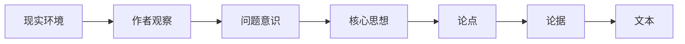

<div align="center">

# Readwelt

### 先忠实读懂文章，再把文章压缩掉的世界重新展开。

面向普通读者的 AI 深度阅读系统

[](https://github.com/lunnynight/readwelt/actions/workflows/ci.yml)
[](pyproject.toml)
[](crates/readwelt-core)
[](LICENSE)

</div>

---

Readwelt 帮助用户深度理解文章。

它不是摘要器，不是 ChatPDF，也不是用来证明“我读过这篇文章”的审计工具。它要解决
的是另一个问题：

> **文章说了什么，以及它为什么会这样说？**

Readwelt 先忠实恢复文章自己的主线、论点、论据和推理结构。只有这层理解被冻结后，
它才开始补回作者省略的前置知识、现实背景、问题意识和概念含义；然后恢复作者观察
世界的方式，检查结论成立的边界，最后提取真正能够迁移到新问题中的方法。

核心路径只有一条：

```text
读懂文章 → 解压知识 → 重建作者模型 → 检查边界 → 迁移原则
```

## 为什么需要逆向阅读

一篇文章不是信息点的集合，而是一条思想形成过程被压缩后的结果：



摘要沿着文本继续压缩，只保留“重点”。逆向阅读从文本向后恢复：

- 作者究竟在回答什么问题；
- 论据为什么能够支持论点；
- 作者默认读者已经知道什么；
- 哪些现实和概念条件使这个问题得以出现；
- 作者看到了什么，又忽略了什么；
- 结论在什么条件下成立、何时失效；
- 离开原始语境后，什么原则仍然可用。

所以最终输出不是一份更长的摘要，而是一个完整的**理解模型**。

## 先读文章，再展开文章

Readwelt 最重要的顺序约束是：

```text
文章内部结构
      ↓ 冻结
文章外部生成条件
```

它不会一开始就拿历史背景、领域理论或外部资料解释文章。那样很容易让背景知识覆盖
作者真正说过的话。

六个阶段按固定顺序工作：

| 阶段 | 核心问题 | 产物 |
|---|---|---|
| 1 · 文章主线 | 作者到底说了什么？ | 核心思想、核心问题、论点、论据、推理链 |
| 2 · 文章结构 | 作者如何组织和推进论证？ | 段落功能以及主张、前提、证据、反对、限定之间的关系 |
| 3 · 知识解压 | 文章压缩了哪些公共知识？ | 背景环境、前置知识、概念展开和待验证问题 |
| 4 · 作者模型 | 作者为什么这样观察和选择？ | 问题意识、核心假设、观察方式、方法选择与竞争解释 |
| 5 · 批判性阅读 | 结论依赖什么条件？ | 隐含假设、适用范围、反例、失效条件和缺失证据 |
| 6 · 思想迁移 | 什么能够离开原语境继续成立？ | 通用方法、必要条件、不可迁移部分和失败测试 |

Stage 3 以后可以补充或挑战前两阶段，但不能偷偷改写文章原本说了什么。Stage 6 也
不能从一句吸引人的话直接提炼“金句”，只能迁移经过边界检验后仍然成立的原则。

## 谁在使用 Readwelt

Readwelt 的最终服务对象是**想理解文章的人**。CLI、Claude Code、Codex、本地模型和
远程 API 都只是执行这套阅读方法的入口或参与者。

| 角色 | 在系统中的位置 |
|---|---|
| 人类读者 | 提出阅读目的，阅读最终理解模型，判断哪些问题值得继续追问 |
| Claude Code / Codex | 代表用户调用 Readwelt，也可以在六个阶段中提交结构化理解候选 |
| 本地或远程模型 | 为各阶段生成候选解释，不拥有阶段顺序和最终结算权 |
| Readwelt | 保存文章主线，控制展开顺序，把候选组织成可继续阅读的完整报告 |

因此，把 Readwelt 挂载给 Claude Code，不是为了帮助 Claude 证明自己读过 context，
也不是让 Claude 审计自己的阅读。正确用法是：

> **当用户要深度理解一篇文章时，让 Claude Code 通过 Readwelt 执行“先读懂、再展开”
> 的完整阅读流程，并把结果交还给用户。**

## 最终得到什么

每次完整阅读会生成一份九部分中文报告：

1. 文章是什么；
2. 核心思想；
3. 核心问题；
4. 论点与论据；
5. 文章逻辑链；
6. 文章背后的世界；
7. 作者的思想模型；
8. 隐含假设与限制；
9. 可迁移原则。

同时生成 canonical JSON `ReadingBundle`，供界面、Agent 或其他学习工具继续读取。

原文锚点、Claim Ledger、provider provenance 和 content-addressed artifacts 是为了
防止后续解压歪曲文章、让中断后的阅读能够继续。它们是理解过程的质量保障，**不是
Readwelt 的产品目的**。

## Quickstart

需要 [uv](https://docs.astral.sh/uv/)、Python 3.13 和 Rust stable。

```powershell
git clone https://github.com/lunnynight/readwelt.git
cd readwelt
uv sync --extra all
```

先导入文章并建立不调用生成模型的语义准备结果：

```powershell
uv run readwelt import .\article.txt --json
# 从输出复制 document_id
uv run readwelt prepare <document_id> --json
```

使用本地 OpenAI-compatible 模型完成六阶段阅读：

```powershell
$env:READWELT_LOCAL_MODEL = "your-model"
$env:READWELT_LOCAL_BASE_URL = "http://127.0.0.1:11434/v1"

uv run readwelt read .\article.txt --provider local --json
```

使用远程 OpenAI-compatible API：

```powershell
$env:READWELT_API_MODEL = "your-model"
$env:READWELT_API_KEY = "..."
$env:READWELT_API_BASE_URL = "https://api.example.com/v1"

uv run readwelt read .\article.txt --provider api --json
```

Xberg `1.0.0rc38` 负责结构化文档抽取；源文件不会被原地修改。所有运行状态默认保存
在当前目录的 `./.readwelt`。

## 挂载到 Claude Code / Codex

启动 stdio MCP server：

```powershell
uv run readwelt-mcp
```

MCP 提供导入、语义准备、完整阅读、状态查询、artifact 读取以及外部 Agent
stage request/candidate 提交工具。

挂载后，Agent 应根据用户的**阅读意图**主动选择 Readwelt，不必等待用户点名工具。
当用户希望理解一篇文章的论证、背景、作者模型、成立边界或可迁移方法时，应进入
逆向阅读流程；普通摘要、代码 context 读取和与文章无关的问答则不需要调用。

推荐交给 Agent 的任务是具体的用户阅读目标，例如：

```text
用 Readwelt 逆向阅读这篇文章。
先忠实恢复文章主线和论证结构，再解压前置知识和现实背景，
恢复作者的问题意识，检查结论边界，最后给出可迁移原则。
```

如果希望 Claude Code 或 Codex 自己参与每一个阅读阶段：

```powershell
uv run readwelt read .\article.txt --provider-mode agent_takeover --json
```

运行会在当前阶段等待。Agent 从 MCP 拉取 `StageRequest + EvidencePacket`，提交候选后
继续下一阶段，最终仍然输出同一份 `ReadingBundle` 和中文阅读报告。

## 为什么仍然需要确定性内核

生成模型擅长恢复问题意识、隐含前提、作者模型和思想迁移，但不应该反复消耗 token
处理哈希、重复检测、锚点覆盖和词法召回。

Readwelt 先构建非生成式 `SemanticAtlas`：

```text
Xberg 结构化输入
        ↓
Rust 规范化 · SHA-256 · MinHash · BM25 · coverage
        ↓
六阶段 RetrievalPlan
        ↓
BM25 + 可选 dense · RRF 融合 · 章节覆盖
        ↓
带命中轨迹与显式遗漏的 EvidencePacket
        ↓
六阶段生成式理解
```

这层计算不生成摘要。它让模型把算力留给真正需要理解的部分，同时明确记录哪些章节
进入了证据包、哪些内容仍然遗漏。

默认安装仍只启用 Rust BM25/coverage，不下载模型。需要中文释义召回时：

```powershell
uv sync --extra all --extra dense
$env:READWELT_DENSE_MODEL = "auto"
uv run readwelt read .\article.txt --provider local --json
```

`auto` 使用固定 revision 的 `Alibaba-NLP/gte-multilingual-base`，运行时自动选择
CUDA 或 CPU，模型缓存在项目的 `.readwelt/cache/models`。文档向量以版本化 `.f32`
文件缓存在 `.readwelt/cache/embeddings`，跨进程复用且不需要数据库；查询则由阅读
目的、阶段职责和已结算的上游 claims 共同生成。
检索轨迹包含 lexical/dense rank、原始分数和 RRF 分数，会随 `StageRequest` 留存。
详细边界见 [检索架构](docs/architecture/dense-retrieval.md)。

## 接口

四个入口共享同一个 `ReadweltApplicationService`：

```text
CLI ─────────┐
Python SDK ──┼──> ReadweltApplicationService ──> six-stage engine ──> report
FastAPI ─────┤                 │                       │
MCP ─────────┘                 │                       └── local / API / Agent
                              │
                    Python orchestration
                              │ PyO3
                    Rust semantic core
```

### CLI

```text
readwelt import <path>                  导入文章
readwelt prepare <document-id>          建立非生成式语义产物
readwelt batch-prepare <paths...>       有界并发准备多篇文章
readwelt read <path-or-document-id>     执行六阶段逆向阅读
readwelt show <run-id>                  查看阅读状态
```

### Python

```python
from readwelt import ReadweltProject

project = ReadweltProject.open(".readwelt")
document = project.import_document("article.txt")
project.prepare(document.document_id)
run = project.read(
    document.document_id,
    provider_selection={"mode": "primary", "primary": "local"},
)
```

### FastAPI

```powershell
uv run readwelt-api
# http://127.0.0.1:8000
```

FastAPI 覆盖文档导入、语义准备、批量准备、启动/查询阅读、artifact 读取，以及外部
Agent 的 stage request pull / candidate submit。

## 本地保存与模型边界

默认项目目录：

```text
.readwelt/
├── objects/      # content-addressed artifacts
├── documents/    # source snapshot indexes
├── runs/         # reading manifests and events
├── batches/      # resumable batch preparation
├── indexes/
└── reports/      # final reading reports
```

选择本地模型时，可以形成全本地阅读链。选择远程 API 或具备联网能力的外部 Agent
时，数据边界由该 provider 决定；“本地保存”不等于“绝不联网”。

多个 provider 同时可用时，Readwelt 不会静默选择。`primary`、`compare`、
`fallback` 和 `agent_takeover` 必须显式指定。

## Readwelt 不是什么

- 不是摘要器、重点提取器或读书笔记生成器；
- 不是 ChatPDF 式问答；
- 不是只讲背景、不忠实阅读文章的思想考古工具；
- 不是用于证明 Agent 是否读过材料的合规审计系统；
- 不是多 Agent 编排平台、知识库或推荐系统；
- 当前没有前端，也不自带模型或搜索引擎。

## Development

```powershell
uv run pytest
uv run ruff check .
uv run mypy
cargo test --workspace
```

Readwelt 当前版本为 `0.1.0`。它优先把“忠实理解文章，再恢复思想结构”这套方法做成
可靠的本地运行时，让未来的界面、Agent 和学习工具读取同一份理解结果。
