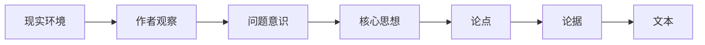

<div align="center">

# Readwelt

### 先忠实读懂文章，再把文章压缩掉的世界重新展开。

面向普通读者的 AI 深度阅读系统

[](https://github.com/lunnynight/readwelt/actions/workflows/ci.yml)
[](pyproject.toml)
[](crates/readwelt-core)
[](LICENSE)

</div>

---

Readwelt 帮助用户深度理解文章。

它不是摘要器，不是 ChatPDF，也不是用来证明“我读过这篇文章”的审计工具。它要解决
的是另一个问题：

> **文章说了什么，以及它为什么会这样说？**

Readwelt 先忠实恢复文章自己的主线、论点、论据和推理结构。只有这层理解被冻结后，
它才开始补回作者省略的前置知识、现实背景、问题意识和概念含义；然后恢复作者观察
世界的方式，检查结论成立的边界，最后提取真正能够迁移到新问题中的方法。

核心路径只有一条：

```text
读懂文章 → 解压知识 → 重建作者模型 → 检查边界 → 迁移原则
```

## 为什么需要逆向阅读

一篇文章不是信息点的集合，而是一条思想形成过程被压缩后的结果：



摘要沿着文本继续压缩，只保留“重点”。逆向阅读从文本向后恢复：

- 作者究竟在回答什么问题；
- 论据为什么能够支持论点；
- 作者默认读者已经知道什么；
- 哪些现实和概念条件使这个问题得以出现；
- 作者看到了什么，又忽略了什么；
- 结论在什么条件下成立、何时失效；
- 离开原始语境后，什么原则仍然可用。

所以最终输出不是一份更长的摘要，而是一个完整的**理解模型**。

## 先读文章，再展开文章

Readwelt 最重要的顺序约束是：

```text
文章内部结构
      ↓ 冻结
文章外部生成条件
```

它不会一开始就拿历史背景、领域理论或外部资料解释文章。那样很容易让背景知识覆盖
作者真正说过的话。

六个阶段按固定顺序工作：

| 阶段 | 核心问题 | 产物 |
|---|---|---|
| 1 · 文章主线 | 作者到底说了什么？ | 先识别标题/开头的预期、全文转折和控制全文的核心主张，再恢复核心问题、论点、论据、推理链 |
| 2 · 文章结构 | 作者如何组织和推进论证？ | 段落功能以及主张、前提、证据、反对、限定之间的关系 |
| 3 · 知识解压 | 文章压缩了哪些公共知识？ | 背景环境、前置知识、概念展开和待验证问题 |
| 4 · 作者模型 | 作者为什么这样观察和选择？ | 问题意识、核心假设、观察方式、方法选择与竞争解释 |
| 5 · 批判性阅读 | 结论依赖什么条件？ | 隐含假设、适用范围、反例、失效条件和缺失证据 |
| 6 · 思想迁移 | 什么能够离开原语境继续成立？ | 通用方法、必要条件、不可迁移部分和失败测试 |

Stage 3 以后可以补充或挑战前两阶段，但不能偷偷改写文章原本说了什么。Stage 6 也
不能从一句吸引人的话直接提炼“金句”，只能迁移经过边界检验后仍然成立的原则。

## 谁在使用 Readwelt

Readwelt 的最终服务对象是**想理解文章的人**。CLI、Claude Code、Codex、本地模型和
远程 API 都只是执行这套阅读方法的入口或参与者。

| 角色 | 在系统中的位置 |
|---|---|
| 人类读者 | 提出阅读目的，阅读最终理解模型，判断哪些问题值得继续追问 |
| Claude Code / Codex | 代表用户调用 Readwelt，也可以在六个阶段中提交结构化理解候选 |
| 本地或远程模型 | 为各阶段生成候选解释，不拥有阶段顺序和最终结算权 |
| Readwelt | 保存文章主线，控制展开顺序，把候选组织成可继续阅读的完整报告 |

因此，把 Readwelt 挂载给 Claude Code，不是为了帮助 Claude 证明自己读过 context，
也不是让 Claude 审计自己的阅读。正确用法是：

> **当用户要深度理解一篇文章时，让 Claude Code 通过 Readwelt 执行“先读懂、再展开”
> 的完整阅读流程，并把结果交还给用户。**

## 最终得到什么

每次完整阅读会生成一份九部分中文报告：

1. 文章是什么；
2. 核心思想；
3. 核心问题；
4. 论点与论据；
5. 文章逻辑链；
6. 文章背后的世界；
7. 作者的思想模型；
8. 隐含假设与限制；
9. 可迁移原则。

同时生成 canonical JSON `ReadingBundle`，供界面、Agent 或其他学习工具继续读取。

原文锚点、Claim Ledger、provider provenance 和 content-addressed artifacts 是为了
防止后续解压歪曲文章、让中断后的阅读能够继续。它们是理解过程的质量保障，**不是
Readwelt 的产品目的**。

## Quickstart

需要 [uv](https://docs.astral.sh/uv/)、Python 3.13 和 Rust stable。

```powershell
git clone https://github.com/lunnynight/readwelt.git
cd readwelt
uv sync --extra all
```

先导入文章并建立不调用生成模型的语义准备结果：

```powershell
uv run readwelt import .\article.txt --json
# 从输出复制 document_id
uv run readwelt prepare <document_id> --json
```

使用本地 OpenAI-compatible 模型完成六阶段阅读：

```powershell
$env:READWELT_LOCAL_MODEL = "your-model"
$env:READWELT_LOCAL_BASE_URL = "http://127.0.0.1:11434/v1"

uv run readwelt read .\article.txt --provider local --json
```

使用远程 OpenAI-compatible API：

```powershell
$env:READWELT_API_MODEL = "your-model"
$env:READWELT_API_KEY = "..."
$env:READWELT_API_BASE_URL = "https://api.example.com/v1"

uv run readwelt read .\article.txt --provider api --json
```

直接复用 Claude Code 宿主当前配置的认证和模型，不需要给 Readwelt 配置 API key：

```powershell
uv run readwelt read .\article.md `
  --provider claude-code `
  --purpose "恢复论证、补全理解缺口、检验边界并提炼可迁移原则" `
  --token-budget 1024 `
  --project .readwelt-claude `
  --json
```

Readwelt 优先定位 Anthropic 官方安装包中的 `claude.exe`，不会盲目执行 PATH 中的
同名 `.cmd` wrapper。认证和模型路由只从 Claude Code 用户 settings 注入宿主子进程，
不会写入 Readwelt 的 manifest、artifact 或日志。默认使用 `--bare`，关闭工具、MCP、
hooks、自动记忆和会话持久化；每个阶段保存宿主版本、实际模型、session id、token
usage、估算 cost 和退出码。可以用 `READWELT_CLAUDE_CODE_BIN`、
`READWELT_CLAUDE_SETTINGS_PATH`、`READWELT_CLAUDE_CODE_MODEL` 和
`READWELT_CLAUDE_CODE_TIMEOUT_SECONDS` 显式覆盖宿主配置。

Xberg `1.0.0rc38` 负责正文抽取；源文件不会被原地修改。对于 EPUB，Readwelt 还会
读取容器内的 NCX 导航树，将 Xberg 的扁平段落恢复到真实章/节标题之下。解析策略
版本进入 snapshot identity，因此结构修复会生成新 snapshot，不会被同正文 digest
的旧缓存静默覆盖。所有运行状态默认保存在项目相对目录。

## Agent 接管与可选 CLI

Readwelt 的默认入口是纯 Skill：宿主可直接读取用户提供的文章并执行 `skills/readwelt`
中的阅读方法，不需要 Readwelt CLI、专用运行时或 MCP 服务。CLI 是可选辅助工具，适用于
需要本地解析、结构化阶段记录或 ArticleGraph 查询的工作流；只有实际调用并留存结果的
辅助功能，才能作为该次阅读的保障。

使用可选 CLI 时，Codex、Claude Code、Gemini 等宿主通过 Skill 决定何时进入深度阅读，
再由短进程 CLI 驱动 `readwelt.agent-turn.v1` 协议：

```text
agent-start
        ↓
generate_stage_candidate
        ↓
agent-submit ──> 下一阶段
        ↓
completed + ReadingBundle + 中文报告
```

`StageRequest` 携带当前证据、阶段规则与机器可读的 `response_schema`。Agent 只提交
候选内容；Readwelt 自动绑定 run、stage、request digest、Agent 身份与模型，并立即
返回下一阶段。这个路径不要求配置 Readwelt 内部 provider。

安装 Skill 后，Agent 应根据用户的**阅读意图**主动选择 Readwelt，不必等待用户点名。
当用户希望理解一篇文章的论证、背景、作者模型、成立边界或可迁移方法时，应进入
逆向阅读流程；普通摘要、代码 context 读取和与文章无关的问答则不需要调用。

推荐交给 Agent 的任务是具体的用户阅读目标，例如：

```text
用 Readwelt 逆向阅读这篇文章。
先忠实恢复文章主线和论证结构，再解压前置知识和现实背景，
恢复作者的问题意识，检查结论边界，最后给出可迁移原则。
```

本地仓库可直接安装 Skill：

```powershell
npx skills add lunnynight/readwelt --skill readwelt
```

CLI 工作流始终传入同一个绝对项目目录：

```powershell
uv run readwelt doctor --project C:\reading\.readwelt --json
uv run readwelt agent-start .\article.txt --project C:\reading\.readwelt --json
uv run readwelt agent-turn run_... --project C:\reading\.readwelt --json
Get-Content .\candidate.json -Raw |
  uv run readwelt agent-submit run_... - --agent-name codex --model host-model `
    --project C:\reading\.readwelt --json
uv run readwelt artifact-get sha256:... --content --project C:\reading\.readwelt --json
uv run readwelt article-graph-page document_... --collection nodes --limit 100 `
  --project C:\reading\.readwelt --json
```

每条命令完成后都会退出，不保留 Readwelt server。运行在当前阶段等待时，可由另一
Agent 宿主通过同一项目目录和 run id 恢复。完整契约见
[Host-neutral Agent integration](docs/architecture/agent-integration.md)。
文章中间表示的当前实现与能力边界见
[ArticleGraph Foundation](docs/architecture/article-graph.md) 和
[Source Plane 架构](docs/architecture/articlegraph-source-plane-baseline.md)。

## 为什么仍然需要确定性内核

生成模型擅长恢复问题意识、隐含前提、作者模型和思想迁移，但不应该反复消耗 token
处理哈希、重复检测、锚点覆盖和词法召回。

Readwelt 先保存原始输入并构建可寻址的 Source Plane，再生成 ArticleGraph 定位底稿；
`SemanticAtlas` 只保留为定位器：

```text
原始文件制品 · source_document root
        ↓
Xberg 正文抽取 · normalized text
        ↓
Source Plane · AnchoredTextUnit · unit/gap ranges · source elements
        ↓
Linguistic / SemanticExtraction · raw GraphExtraction · Canonicalizer
        ↓
advisory ArticleGraph locating signals
        ↓
SourceIndex · ProvenanceLedger · typed source closure
        ↓
bounded/paged StageView provider envelope
        ↓
六阶段 AI 读懂 · 解压 · 重建 · 边界检验 · 迁移
```

这层计算不生成最终理解。它保留原始字节、精确范围、原始候选、能力缺口、合并决策、
冲突和双向来源索引，让六阶段在硬序列化预算内分页读取，并能从 Provider 实际看到的
材料回到 Source Plane。ArticleGraph 对象只是机器定位候选；阶段结论可以引用它们，
但不能回写成 source fact。

已 prepare 的 ArticleGraph 也可通过 CLI 或
`GET /v1/documents/{document_id}/article-graph/{collection}` 直接分页读取。
`collection` 支持 `nodes`、`edges`、`claims`、`mentions`；响应中的不透明
`next_cursor` 绑定 document、collection 和 graph digest，图版本变化或跨集合复用时会
明确拒绝，最后一页返回 `null`。

原始扫描 PDF 即使没有 OCR 文本也会保留为可寻址 source root；这不等于已经恢复文字、
版面或页几何。Xberg 当前实测以正文抽取为主，未暴露所需结构。可选
`docling==2.114.0` 结构后端只在 PDF 无结构或空文本时触发；它不会替换正常的
TXT/HTML/Xberg 路径，也不会替换原始 PDF source root。CompletionPlan、外部研究闭环
和 Completion Engine 尚未在本 change 实现。

Docling 需要显式安装 `structural` extra，并使用官方工具预下载本地模型；Readwelt
不会静默下载模型：

```powershell
uv sync --extra structural
$env:HF_HUB_DISABLE_PROGRESS_BARS = "1"
.\.venv\Scripts\docling-tools.exe models download layout tableformer rapidocr `
  -o .research-inputs\docling-artifacts --quiet
$env:READWELT_DOCLING_ARTIFACTS_PATH = (
  Resolve-Path ".research-inputs\docling-artifacts"
).Path
```

模型下载是显式的准备步骤；阅读运行时不会联网补模型。没有该目录、依赖、RapidOCR
引擎或正确版本时，fallback 会记录明确的 capability failure，
继续保留 Xberg 结果和原始 source root。

默认安装不下载 NLP 或 dense 模型，使用确定性 linguistic/semantic 降级 backend。
BM25+/coverage 仍可帮助 StageView 定位原文；dense 是可选 locator，不是
ArticleGraph 或 Completion Engine 的阻塞依赖。需要中文释义定位时：

```powershell
uv sync --extra all --extra dense
$env:READWELT_DENSE_MODEL = "auto"
uv run readwelt read .\article.txt --provider local --json
```

`auto` 使用固定 revision 的 `Alibaba-NLP/gte-multilingual-base`，运行时自动选择
CUDA 或 CPU，模型缓存在项目的 `.readwelt/cache/models`。文档向量以版本化 `.f32`
文件缓存在 `.readwelt/cache/embeddings`，跨进程复用且不需要数据库；查询则由阅读
目的、阶段职责和已结算的上游 claims 共同生成。
定位轨迹包含 lexical/dense rank、原始分数和 RRF 分数，会随 `StageView` 和
`StageRequest` 留存。
当预算足以容纳全文时走 `full-coverage-v1` 快路径，保持原文顺序并完全跳过向量计算；
hybrid 只在预算确实需要筛选证据时启动。
详细边界见 [检索架构](docs/architecture/dense-retrieval.md)。
BM25、BM25+、BM25L 的可重复中文 seed 验收和真实语料边界见
[检索基准](docs/architecture/retrieval-benchmark.md)。

## 接口

三个入口共享同一个 `ReadweltApplicationService`：

```text
CLI ─────────┐
Python SDK ──┼──> ReadweltApplicationService ──> six-stage engine ──> report
FastAPI ─────┘                 │                       │
                              │                       └── local / API / Agent
                              │
                    Python orchestration
                              │ PyO3
                    Rust semantic core
```

### CLI

```text
readwelt import <path>                  导入文章
readwelt prepare <document-id>          建立非生成式语义产物
readwelt batch-prepare <paths...>       有界并发准备多篇文章
readwelt read <path-or-document-id>     执行六阶段逆向阅读
readwelt show <run-id>                  查看阅读状态
readwelt doctor                         检查短进程 CLI 环境
readwelt agent-start <path>             启动宿主 Agent 阅读
readwelt agent-turn <run-id>            恢复当前阶段
readwelt agent-submit <run-id> -        从 stdin 提交候选
readwelt artifact-get <sha256>          获取完成制品
```

### Python

```python
from readwelt import ReadweltProject

project = ReadweltProject.open(".readwelt")
document = project.import_document("article.txt")
project.prepare(document.document_id)
run = project.read(
    document.document_id,
    provider_selection={"mode": "primary", "primary": "local"},
)
```

### FastAPI

```powershell
uv run readwelt-api
# http://127.0.0.1:8000
```

FastAPI 覆盖文档导入、语义准备、批量准备、启动/查询阅读、artifact 读取，以及外部
Agent 的 stage request pull / candidate submit。

## 本地保存与模型边界

默认项目目录：

```text
.readwelt/
├── objects/      # content-addressed artifacts
├── documents/    # source snapshot indexes
├── runs/         # reading manifests and events
├── batches/      # resumable batch preparation
├── indexes/
└── reports/      # final reading reports
```

选择本地模型时，可以形成全本地阅读链。选择远程 API 或具备联网能力的外部 Agent
时，数据边界由该 provider 决定；“本地保存”不等于“绝不联网”。

多个 provider 同时可用时，Readwelt 不会静默选择。`primary`、`compare`、
`fallback` 和 `agent_takeover` 必须显式指定。

## Readwelt 不是什么

- 不是摘要器、重点提取器或读书笔记生成器；
- 不是 ChatPDF 式问答；
- 不是只讲背景、不忠实阅读文章的思想考古工具；
- 不是用于证明 Agent 是否读过材料的合规审计系统；
- 不是多 Agent 编排平台、知识库或推荐系统；
- 当前没有前端，也不自带模型或搜索引擎。

## Development

```powershell
uv run pytest
uv run ruff check .
uv run mypy
cargo test --workspace
```

Readwelt 当前版本为 `0.1.0`。默认使用纯 Skill 阅读；本地运行时和 CLI 是可选辅助能力，
不构成每次阅读都已执行的保障。语义评测由 `evals/readwelt/grader.md` 与盲比对 rubric
辅助；`check_quotes.py` 只核对字面片段，不证明解释正确。过程声明按可用记录评估；纯
Skill 模式不承诺硬性阻止模型输出无依据的过程声明。

ArticleGraph 的程序评分将旧的“comprehension”结果改名为 `comprehension_lexical_screen`，
只作词汇覆盖诊断，不是语义理解结论，也不再纳入生成的新预注册中的主要发布指标。已冻结的
`benchmarks/articlegraph_agent_reading/d1/preregistration.json` 保持原样作为历史记录，不代表
当前评分定义。

可选引文核对命令：

```powershell
uv run python evals/readwelt/check_quotes.py source.md report.md
```

它只核对报告中的弯引号片段是否在所给来源中逐字出现：返回码 `0` 表示全部匹配，
`1` 表示至少一处未匹配，`2` 表示未找到显式引文。字面匹配不证明引文归属或解释成立；
标点差异也可能导致未匹配。grader、comparator 和测试用例只用于开发评估，不会自动参与
每次 Skill 阅读。
